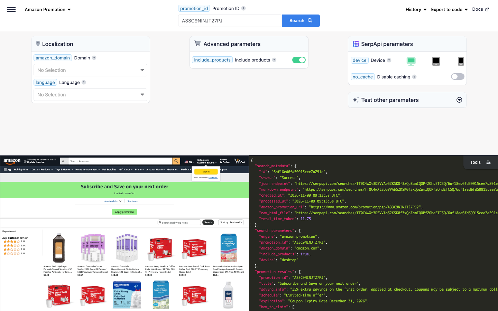

# Amazon Promotion Scraper

Scrape Amazon promotion pages with SerpApi's Amazon Promotion API. Get a coupon or promotion's title, savings, schedule, expiration date, steps to claim it, and terms, plus the products it applies to, with their ASIN, title, brand, price, rating, and reviews.

## How to scrape Amazon promotions

Get the details of an Amazon promotion and the products it applies to with a simple GET request:

```text
https://serpapi.com/search?engine=amazon_promotion&promotion_id=A33C9NINJT27PJ&include_products=true&api_key=SERPAPI_API_KEY
```

- `promotion_id` is the Amazon ID of the promotion, e.g., `A33C9NINJT27PJ` for a Subscribe & Save coupon. It's the ID in the link of the promotion page, `https://www.amazon.com/promotion/psp/A33C9NINJT27PJ`, and in the `/promotion/details/popup/A33C9NINJT27PJ` link of its terms.
- `api_key` is your SerpApi API key. Replace `SERPAPI_API_KEY` with it.
- `include_products` set to `true` also gets the products that qualify for the promotion. Responses take longer with it.
- `amazon_domain` sets the Amazon marketplace, e.g., `amazon.co.uk` or `amazon.de`. Defaults to `amazon.com`.

Promotions expire, and a promotion that has ended returns the error "Promotion has ended or was not found." If the example ID no longer works, pick a current one from a coupon on an Amazon product page, or from the [Amazon Product API](https://serpapi.com/amazon-product-api?utm_source=github_amazon_promotion_scraper) results, where the coupons in `product_results.coupons` link to their promotion with `serpapi_amazon_promotion_link`.

[Register at SerpApi](https://serpapi.com?utm_source=github_amazon_promotion_scraper) to get your API key, and keep it private.

### Playground

Try the request live in the [SerpApi Playground](https://serpapi.com/playground?engine=amazon_promotion&promotion_id=A33C9NINJT27PJ&include_products=true&utm_source=github_amazon_promotion_scraper).

[](https://serpapi.com/playground?engine=amazon_promotion&promotion_id=A33C9NINJT27PJ&include_products=true&utm_source=github_amazon_promotion_scraper)

## Code examples

The code examples read your API key from the `SERPAPI_API_KEY` environment variable:

```bash
export SERPAPI_API_KEY="SERPAPI_API_KEY"
```

Each example gets a Subscribe & Save promotion with its qualifying products, and prints the title, savings, and expiration date of the promotion, followed by the title and price of each product.

### curl integration

Send the request with curl, which prints the full JSON response:

```bash
curl --get https://serpapi.com/search \
 --data-urlencode engine="amazon_promotion" \
 --data-urlencode promotion_id="A33C9NINJT27PJ" \
 --data-urlencode include_products="true" \
 --data-urlencode api_key="$SERPAPI_API_KEY"
```

### JavaScript integration

Install the [SerpApi JavaScript library](https://github.com/serpapi/serpapi-javascript) and set your project to use ES modules:

```bash
npm install serpapi
npm pkg set type=module
```

Create an `index.js` file:

```javascript
import { getJson } from "serpapi";

const results = await getJson({
  engine: "amazon_promotion",
  api_key: process.env.SERPAPI_API_KEY,
  promotion_id: "A33C9NINJT27PJ",
  include_products: "true",
});

const promotion = results.promotion_results ?? {};
console.log(promotion.title, promotion.saving_info, promotion.expiration);
for (const item of results.qualifying_items ?? []) {
  console.log(item.title, item.price);
}
```

Run it with `node index.js`.

### Python integration

Install the [SerpApi Python library](https://github.com/serpapi/serpapi-python):

```bash
pip install serpapi
```

Create a `main.py` file:

```python
import os
import serpapi

client = serpapi.Client(api_key=os.getenv("SERPAPI_API_KEY"))
results = client.search({
    "engine": "amazon_promotion",
    "promotion_id": "A33C9NINJT27PJ",
    "include_products": "true",
})

promotion = results.get("promotion_results", {})
print(promotion.get("title"), promotion.get("saving_info"), promotion.get("expiration"))
for item in results.get("qualifying_items", []):
    print(item["title"], item.get("price"))
```

Run it with `python main.py`.

### Ruby integration

Install the [SerpApi Ruby library](https://github.com/serpapi/serpapi-ruby):

```bash
gem install serpapi
```

Create a `main.rb` file:

```ruby
require "serpapi"

client = SerpApi::Client.new(engine: "amazon_promotion", api_key: ENV.fetch("SERPAPI_API_KEY"))
results = client.search(promotion_id: "A33C9NINJT27PJ", include_products: "true")

promotion = results.fetch(:promotion_results, {})
puts "#{promotion[:title]} #{promotion[:saving_info]} #{promotion[:expiration]}"
results.fetch(:qualifying_items, []).each do |item|
  puts "#{item[:title]} #{item[:price]}"
end

client.close
```

Run it with `ruby main.rb`.

### PHP integration

Install the [SerpApi PHP library](https://github.com/serpapi/serpapi-php):

```bash
composer require serpapi/serpapi-php
```

Create an `index.php` file:

```php
<?php
require 'vendor/autoload.php';

use SerpApi\Client;

$client = new Client(getenv('SERPAPI_API_KEY'), 'amazon_promotion');
$results = $client->search([
  'promotion_id' => 'A33C9NINJT27PJ',
  'include_products' => 'true',
]);

$promotion = $results->promotion_results ?? null;
echo ($promotion->title ?? '') . ' ' . ($promotion->saving_info ?? '') . ' ' . ($promotion->expiration ?? '') . PHP_EOL;
foreach ($results->qualifying_items ?? [] as $item) {
  echo $item->title . ' ' . ($item->price ?? '') . PHP_EOL;
}
```

Run it with `php index.php`.

### Go integration

Create a Go module and install the [SerpApi Go library](https://github.com/serpapi/serpapi-golang):

```bash
go mod init example.com/promotion
go get github.com/serpapi/serpapi-golang
```

Create a `main.go` file:

```go
package main

import (
	"fmt"
	"os"

	"github.com/serpapi/serpapi-golang"
)

func main() {
	setting := serpapi.NewSerpApiClientSetting(os.Getenv("SERPAPI_API_KEY"))
	setting.Engine = "amazon_promotion"
	client := serpapi.NewClient(setting)

	results, err := client.Search(map[string]string{
		"promotion_id":     "A33C9NINJT27PJ",
		"include_products": "true",
	})
	if err != nil {
		panic(err)
	}

	promotion, _ := results["promotion_results"].(map[string]interface{})
	fmt.Println(promotion["title"], promotion["saving_info"], promotion["expiration"])
	qualifyingItems, _ := results["qualifying_items"].([]interface{})
	for _, entry := range qualifyingItems {
		item := entry.(map[string]interface{})
		fmt.Println(item["title"], item["price"])
	}
}
```

Run it with `go run .`.

### Rust integration

Create a Cargo project and add the [SerpApi Rust library](https://github.com/serpapi/serpapi-rust) and Tokio:

```bash
cargo new promotion && cd promotion
cargo add serpapi tokio --features tokio/full
```

Replace `src/main.rs` with:

```rust
use serpapi::serpapi::Client;
use std::collections::HashMap;
use std::env;

#[tokio::main]
async fn main() -> Result<(), Box<dyn std::error::Error>> {
    let mut default = HashMap::new();
    default.insert("api_key".to_string(), env::var("SERPAPI_API_KEY")?);
    default.insert("engine".to_string(), "amazon_promotion".to_string());
    let client = Client::new(default)?;

    let mut parameter = HashMap::new();
    parameter.insert("promotion_id".to_string(), "A33C9NINJT27PJ".to_string());
    parameter.insert("include_products".to_string(), "true".to_string());

    let results = client.search(parameter).await?;
    let promotion = &results["promotion_results"];
    println!(
        "{} {} {}",
        promotion["title"].as_str().unwrap_or_default(),
        promotion["saving_info"].as_str().unwrap_or_default(),
        promotion["expiration"].as_str().unwrap_or_default()
    );
    if let Some(qualifying_items) = results["qualifying_items"].as_array() {
        for item in qualifying_items {
            println!(
                "{} {}",
                item["title"].as_str().unwrap_or_default(),
                item["price"].as_str().unwrap_or_default()
            );
        }
    }
    Ok(())
}
```

Run it with `cargo run`.

### Other programming languages

Official libraries are also available for [Java](https://github.com/serpapi/serpapi-java), [.NET](https://github.com/serpapi/serpapi-dotnet), [Swift](https://github.com/serpapi/serpapi-swift), and [C++](https://github.com/serpapi/serpapi-cpp). See [SerpApi integrations](https://serpapi.com/integrations?utm_source=github_amazon_promotion_scraper) for setup guides, or use a simple GET request from any programming language.

### Errors

Failed requests return an HTTP error status and a JSON body with an `error` message. The most common are `401` for an invalid API key, `400` for a missing required parameter such as `promotion_id`, and `429` when you exceed your hourly throughput limit or run out of searches. See [API status and error codes](https://serpapi.com/api-status-and-error-codes?utm_source=github_amazon_promotion_scraper) for the full list.

## Output formats: JSON and Markdown

Choose structured JSON for applications or Markdown for LLMs and AI agents:

- JSON is the default output and is useful when you need individual result fields.
- Add `output=md` to receive Markdown instead, which is more token-efficient.

Markdown is plain text, not JSON: YAML front matter with the search metadata, followed by the details of the promotion, the steps to claim it, and tables of the terms and the qualifying items. Read the response body as text instead of parsing it.

| Client | Markdown request |
|--------|------------------|
| curl | `--data-urlencode output="md"` |
| Python | `client.search({..., "output": "md"})` |
| PHP | `$client->md([...])` |
| Rust | `client.md(parameter).await?` |

If your SDK doesn't have a Markdown helper yet, send a plain HTTP request with `output=md` and read the body as text. Learn more about [Markdown output](https://serpapi.com/markdown-output?utm_source=github_amazon_promotion_scraper).

## Amazon Promotion API parameters

See the [Amazon Promotion API documentation](https://serpapi.com/amazon-promotion-api?utm_source=github_amazon_promotion_scraper) for more details.

| Name | Description | Requirement |
|------|-------------|-------------|
| **Search query** | | |
| `promotion_id` | The Amazon ID of the promotion (e.g., `A33C9NINJT27PJ`). It's the ID in the `/promotion/psp/<ID>` link of the promotion page and the `/promotion/details/popup/<ID>` link of its terms. | Required |
| **Localization** | | |
| `amazon_domain` | The Amazon domain to use (e.g., `amazon.co.uk`, `amazon.de`). Defaults to `amazon.com`. `amazon.cn` isn't supported, as Amazon no longer serves promotion pages there. See [Amazon domains](https://serpapi.com/amazon-domains?utm_source=github_amazon_promotion_scraper) for supported domains. | Optional |
| `language` | The language of the results, as a `<language>_<REGION>` locale (e.g., `en_US` or `es_US` on amazon.com, `ja_JP` on amazon.co.jp). See [Amazon languages](https://serpapi.com/amazon-languages?utm_source=github_amazon_promotion_scraper) for supported languages. | Optional |
| **Advanced parameters** | | |
| `include_products` | Set to `true` to also get the products that qualify for the promotion, which makes responses slower, or `false` (default) to only get the details of the promotion. | Optional |
| **SerpApi parameters** | | |
| `engine` | Set to `amazon_promotion`. | Required |
| `api_key` | Your private SerpApi API key. | Required |
| `device` | Set to `desktop` (default), `tablet`, or `mobile`. | Optional |
| `no_cache` | Set to `true` to request fresh results instead of using the one-hour cache. Can't be combined with `async`. | Optional |
| `async` | Set to `true` for later retrieval through the [Searches Archive API](https://serpapi.com/search-archive-api?utm_source=github_amazon_promotion_scraper). Can't be combined with `no_cache` or used with Ludicrous Speed enabled. | Optional |
| `zero_trace` | Enterprise only. Set to `true` to skip storing search parameters, files, and metadata on SerpApi servers. | Optional |
| `output` | Set to `json` (default), `html` for the raw HTML retrieved, or `md` for Markdown. | Optional |
| `json_restrictor` | Limit the JSON response to the fields you need. See the [JSON Restrictor](https://serpapi.com/json-restrictor?utm_source=github_amazon_promotion_scraper) documentation. | Optional |

## Available data on Amazon promotions (JSON response)

`promotion_results` describes the promotion, and with `include_products=true`, `qualifying_items` lists the products it applies to. The field guides below describe the possible fields and their types; they aren't literal API responses.

### What you get depends on the promotion

Some fields appear only when the promotion page shows them, or when you ask for them:

| Promotion | Fields |
|-----------|--------|
| Any promotion, with `include_products=true` | `qualifying_items` with the products the promotion applies to |
| A promotion with an incomplete list of products, because it's very large or Amazon didn't return the product grid | `qualifying_items_truncated` set to `true` |
| A coupon without a list of products | No `qualifying_items`, and a generic `title`, e.g., View promotion details |
| Terms with headings or lists | `terms[].title` and `terms[].items`, next to or instead of `terms[].text` |

`price` and `extracted_price` are the prices of the products before the discount of the promotion. If the list is incomplete because Amazon didn't return the product grid, try again later with `no_cache=true`. To get the coupons and other promotions of a product, use the [Amazon Product API](https://serpapi.com/amazon-product-api?utm_source=github_amazon_promotion_scraper).

### Promotion details

`promotion_results` describes the promotion:

```json
{
  "promotion_results": {
    "promotion_id": "String - Amazon ID of the promotion, e.g., A33C9NINJT27PJ",
    "title": "String - Title of the promotion, e.g., Subscribe and Save on your next order",
    "saving_info": "String - Savings the promotion provides, e.g., 25% extra savings on the first order, applied at checkout",
    "schedule": "String - When the promotion runs, e.g., Limited-time offer, or a date range",
    "expiration": "String - Expiration date of the promotion, as displayed, e.g., Coupon Expiry Date December 31, 2026",
    "how_to_claim": "Array[String] - Steps to claim the promotion, e.g., Select the Clip Coupon button.",
    "terms": [
      {
        "title": "String - Heading of the section of the terms, e.g., How to redeem a coupon:",
        "text": "String - Introductory text of the section",
        "items": "Array[String] - Terms listed in the section"
      }
    ],
    "link": "String - Link to the promotion page on Amazon"
  }
}
```

### Qualifying items

With `include_products=true`, each item in `qualifying_items` is a product the promotion applies to:

```json
{
  "qualifying_items": [
    {
      "position": "Integer - Position of the product in the list of qualifying items",
      "asin": "String - ASIN of the product, e.g., B09HHDW53K",
      "serpapi_amazon_product_link": "String - SerpApi link to the details of the product with the Amazon Product API",
      "title": "String - Title of the product",
      "link": "String - Link to the product on Amazon",
      "thumbnail": "String - Link to the image of the product",
      "brand": "String - Brand of the product, e.g., Amazon Basics",
      "price": "String - Price of the product, as displayed, e.g., $8.19",
      "extracted_price": "Float - Price of the product, as a number, e.g., 8.19",
      "rating": "Float - Average rating of the product, e.g., 4.8",
      "reviews": "Integer - Number of reviews of the product, e.g., 28680",
      "prime": "Boolean - Present and true when the product is Prime eligible",
      "merchant_id": "String - ID of the seller of the product, e.g., ATVPDKIKX0DER"
    }
  ],
  "qualifying_items_truncated": "Boolean - Present and true when the list of qualifying items is incomplete"
}
```

## AI agents and no-code

### MCP

Give AI agents and assistants an Amazon promotion tool with the hosted [SerpApi MCP server](https://github.com/serpapi/serpapi-mcp) at `https://mcp.serpapi.com/mcp`.

Claude Code:

```bash
claude mcp add --transport http serpapi https://mcp.serpapi.com/mcp --header "Authorization: Bearer $SERPAPI_API_KEY"
```

Codex, which reads the key from `SERPAPI_API_KEY`:

```bash
codex mcp add serpapi --url https://mcp.serpapi.com/mcp --bearer-token-env-var SERPAPI_API_KEY
```

Other MCP clients:

```json
{
  "mcpServers": {
    "serpapi": {
      "type": "http",
      "url": "https://mcp.serpapi.com/SERPAPI_API_KEY/mcp"
    }
  }
}
```

The server's engine catalog includes the `amazon_promotion` engine, and its `serpapi://engines/amazon_promotion` resource describes the parameters. Ask your agent to get the details and qualifying products of an Amazon promotion with the `amazon_promotion` engine. The resulting tool call looks like this:

```json
{
  "name": "search",
  "arguments": {
    "params": {
      "engine": "amazon_promotion",
      "promotion_id": "A33C9NINJT27PJ",
      "include_products": "true"
    }
  }
}
```

See the [MCP integration guide](https://serpapi.com/integrations/mcp?utm_source=github_amazon_promotion_scraper) for more clients and self-hosting.

### CLI

Get Amazon promotions from your terminal or from AI agent workflows with the [SerpApi CLI](https://github.com/serpapi/serpapi-cli):

```bash
brew tap serpapi/homebrew-tap
brew install serpapi-cli
```

The CLI picks up `SERPAPI_API_KEY` from your environment. You can also run `serpapi login` to save a key.

```bash
serpapi search engine=amazon_promotion promotion_id=A33C9NINJT27PJ include_products=true
serpapi search engine=amazon_promotion promotion_id=A33C9NINJT27PJ include_products=true --fields "promotion_results.{title, saving_info, expiration}"
serpapi search engine=amazon_promotion promotion_id=A33C9NINJT27PJ include_products=true output=md
```

### No-code tools

Use SerpApi APIs without writing code:

- [NoCodeSerpApi](https://nocodeserpapi.com/)
- [SerpApi with n8n](https://serpapi.com/blog/tag/n8n/)
- [SerpApi with Make](https://serpapi.com/blog/tag/make/)
- [More integrations](https://github.com/serpapi/serpapi-integrations/)

## Use cases

- Track the coupons and promotions on your products and competing products, with their savings and expiration dates.
- Find all the products a coupon applies to, with their prices, ratings, and reviews.
- Build deal and coupon pages with the steps to claim each promotion and its terms.
- Alert shoppers when a promotion covers a product they follow, or before it expires.
- Compare promotions across Amazon marketplaces with `amazon_domain`.
- Give AI agents and RAG pipelines the details and terms of Amazon promotions.

## Related scrapers

- [Amazon Product Scraper](https://github.com/serpapi/amazon-product-scraper): product pages by ASIN, with the coupons and promotion IDs of each product
- [Amazon Scraper](https://github.com/serpapi/amazon-scraper): Amazon search results
- [Google Shopping Scraper](https://github.com/serpapi/google-shopping-scraper): products and prices from Google Shopping

## Resources

- [How to Scrape Amazon Promotions Coupons](https://serpapi.com/blog/scrape-amazon-promotions-coupons/)

## Contact

Feel free to reach out at [contact@serpapi.com](mailto:contact@serpapi.com).
